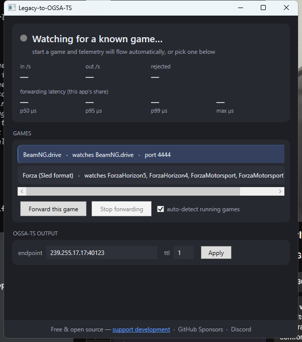

# OGSA-TS Bridge

> [!IMPORTANT]
> **In active development.** The Bridge works end to end and is covered by
> automated tests, but none of its game mappings have been verified against
> the live games yet: axis directions and units come from each format's
> documentation (see
> [Axis conventions & verification](#axis-conventions--verification)).
> Expect rough edges, and please report what you find on
> [Discord](https://discord.gg/tseF4Q6U99). Windows only for now.
>
> Development is funded by
> [sponsorship](https://github.com/sponsors/BrianGilbert), which moves this
> and the rest of the [OGSA](https://github.com/Open-Game-Standards-Alliance)
> work forward.

Translate telemetry from games that don't support the
[OGSA Telemetry Standard](https://github.com/Open-Game-Standards-Alliance/OGSA-Telemetry-Standard)
and retransmit it as **OGSA-TS UDP** (OMT1 / Cap'n Proto, multicast) — so
motion rigs, dashboards, and haptics built against the standard can consume
any game, natively.

Design priority #1: **lowest possible latency** on the forward path. Every
legacy packet is parsed, translated, and on the wire within the same
syscall-to-syscall span — no timers, no queues, no cross-thread hops.
Typical measured cost (parse → encode → send) is **tens of microseconds**,
invisible next to a game physics tick.

```
game (legacy telemetry)                     any OGSA-TS receiver
   │ UDP, its own format                        ▲
   ▼                                            │ UDP multicast 239.255.17.17:40123
┌────────────────────────────────────────────────┴──────────────┐
│ ogsa-ts-bridge                                                │
│  receive thread ─ zero-copy parse ─ cached-graph encode ─ send │
│  (process watcher picks the source, cold path, 2 s cadence)   │
└───────────────────────────────────────────────────────────────┘
```

Community & support: [Discord](https://discord.gg/tseF4Q6U99) · [Support development](https://github.com/sponsors/BrianGilbert)

Two frontends share one engine:

- **GUI** (`OgsaTsBridge.Gui.exe`, WPF) — shows which game is being
  translated with live rates and this app's own latency percentiles,
  lets you manually pick a game when auto-detection finds nothing, edits
  the output endpoint, and carries the donation links. The UI only ever
  reads snapshots and issues supervisor commands — nothing it does can
  touch the forward path.
- **Console** (`ogsa-ts-bridge`) — same engine, for headless/service use.



## Getting the app

**Release download**: every push to `main` auto-cuts a CalVer release
(`vYYYY.MM.DD`, run-number suffixed on same-day repeats) — grab
`ogsa_ts_bridge-[YYYY.MM.DD]-win64.zip` from GitHub Releases, unzip
anywhere, and run `OgsaTsBridge.Gui.exe` (desktop app) or
`ogsa-ts-bridge.exe` (headless console). Self-contained — no .NET
install needed.

**From source** (needs the .NET 8 SDK):

```bash
dotnet publish src/OgsaTsBridge    -c Release -r win-x64 --self-contained true -o artifacts/release
dotnet publish src/OgsaTsBridge.Gui -c Release -r win-x64 --self-contained true -o artifacts/release
```

Both executables land in `artifacts/release/` (gitignored). For dev
runs without publishing: `dotnet run --project src/OgsaTsBridge.Gui` or
`dotnet run --project src/OgsaTsBridge -- run` (bare
`ogsa-ts-bridge.exe` launches the GUI when both are published together).
Releases are CalVer and
cut automatically by CI on merge to `main` — never push unverified work
to `main` (a push publishes).

## Quick start

```bash
dotnet build
dotnet run --project src/OgsaTsBridge -- run
```

With no further arguments the app runs in **auto mode**: it watches for
known game executables, matching plain process names, and activates the matching source
when a game launches, stopping it when the game exits. No telemetry
probing, no Steam dependency; non-Steam games work identically.

```
11:15:55 ForzaHorizon5 running - forwarding Forza (Sled format) (0.0.0.0:5300 -> 239.255.17.17:40123)
in    60/s  out    60/s  rej 0  |  fwd us p50      61  p95     94  p99    120  max    210
11:16:11 ForzaHorizon5 exited - source stopped, watching again
```

The status line's `fwd us` percentiles measure this app's own processing
(receive-syscall return → send-syscall return) — the only latency it adds
to the chain.

Pin a source manually with `--source` (the console equivalent of the
GUI's "Forward this game"):

```bash
dotnet run --project src/OgsaTsBridge -- run --source beamng
ogsa-ts-bridge list          # source catalogue, watched processes, options
ogsa-ts-bridge list beamng   # one source's options (--set key=value)
```

| Option | Default | Meaning |
|---|---|---|
| `--source <id>` | auto | pin one source, skip process watching |
| `--in-port <n>` | source default | UDP port the game sends to |
| `--out <ip:port>` | `239.255.17.17:40123` | OGSA-TS endpoint (multicast or unicast) |
| `--ttl <n>` | 1 | multicast scope (1 = local subnet) |
| `--max-hz <n>` | 1000 | motion frame cap; below it, output cadence = input cadence |
| `--priority <p>` | above | forwarder thread priority (`normal`/`above`/`high`) |
| `--no-stats` | off | silence the 1 Hz status line |

## Sources

| Source | Games (watched executables) | Input | Object payload |
|---|---|---|---|
| `beamng` | BeamNG.drive | 88-byte UDP (port 4444), telemetry output ON in Options → Gameplay | pose + world kinematics |
| `forza-sled` | Forza Horizon 4/5, Forza Motorsport 7+ | 232-byte "Sled" UDP (port 5300), Settings → Data Out → this machine, packet type Sled | pose + body dynamics + 4 wheel drive points + channels |
| `ego` | Dirt Rally 2 (`dirtrally2`), DiRT 4 (`dirt4`) | EGO UDP (port 20777), byte order auto-detected | pose + world kinematics + wheels + g-force channels |
| `sms` | pCARS2 (`pCARS2AVX`), AMS2 (`AMS2AVX`), pCARS3 (`pCARS3`) | SMS UDP (port 5606) | pose + body dynamics + channels |
| `f1` | F1 2020–2024 | Codemasters UDP (port 20777), motion + telemetry packets | pose + body dynamics + channels (2023+) |
| `wrc` | WRC (Generations-era, `WRC`) | WRC UDP (port 20777) | pose + world kinematics + channels |
| `lfs` | Live for Speed (`LFS`) | OutSim UDP (port 3156) | pose + body dynamics (derived specific force) |
| `ac-family` | Assetto Corsa (`acs`), ACC (`acc`) | `Local\acpmf_physics` shared memory, 2 ms poll | pose + body dynamics + wheels + channels |

A **source is a format, not a game** — when a new title is confirmed to
emit a covered format, it joins the executable watch list with no new
code. Further formats (GT7, iRacing, RaceRoom, ETS2,
DCS, X-Plane, the HTTP/journal/memory-read families) are on the roadmap
in [docs/PLUGINS.md](docs/PLUGINS.md) — the full guide to writing and
registering new sources.

Channel mapping follows the standard's [Common Channels Annex] where a
concept is ratified (`engine.rpm`, `vehicle.speed`, …); wheel-level data
rides schema `WheelState` drive points rather than flat channels, keeping
discovery well under one Ethernet MTU.

## For game developers

Does your game already output telemetry, over UDP, shared memory or
another format? If you'd like it supported by the Bridge, get in touch on
[Discord](https://discord.gg/tseF4Q6U99). Documentation of your format and
a game key, so the mapping can be verified against the live game, are the
main things needed. The Bridge then serves every OGSA-TS receiver with no
changes to your game.

For new or updated games, sending OGSA-TS directly removes the need for a
bridge altogether: the
[engine plugins](https://github.com/Open-Game-Standards-Alliance) for
Unity, Unreal and Godot, and the .NET and C++ cores for custom engines,
make that a small integration.

## Latency design notes

The whole point of this app is to not be visible in the latency budget:

- **One thread owns the path.** A dedicated, above-normal-priority thread
  blocks in `ReceiveFrom`; the kernel wakes it the instant a datagram
  lands. From there it parses, translates, encodes, and `SendTo`s on the
  same thread — zero hand-offs.
- **Pass-through cadence.** Every accepted input packet produces exactly
  one motion frame (capped by `--max-hz` as a guardrail). No rate
  quantisation, no batching delay. The loopback tests assert 1:1
  input:output.
- **Zero-allocation parse.** `MemoryMarshal.Read<T>` over the receive
  buffer — no per-packet marshalling, no struct copies to the heap.
- **Cached wire graphs.** The frame graph (the vendored core's generated
  schema writers) is built once at declaration and rewritten in place
  each tick (the upstream `TelemetryPublisher` technique); the only
  per-frame allocations are the encoder's small word buffer and the
  datagram. No Cap'n Proto runtime ships with the app.
- **Windows traps handled.** `SIO_UDP_CONNRESET` disabled (ICMP
  port-unreachable replies must not stall receives), `SIO_LOOPBACK_FAST_PATH`
  on loopback binds, 1 MiB receive buffer so bursts queue in the kernel
  instead of dropping (a drop costs a full source interval; buffering
  costs microseconds).
- **Discovery double-send + keepalive.** The sender's first multicast
  datagrams can be dropped by stack warm-up (observed on Windows);
  `Start` sends discovery twice, and a 500 ms receive timeout drives the
  standard's 2 s discovery re-send even when the game stream pauses
  (e.g. Forza menus), so late-joining receivers never wait longer than
  the standard's cadence.

Receiver-side liveness follows the standard: motion frames are the
heartbeat; ~1 s of silence (5× a 60 Hz tick) marks the session stale.

## Axis conventions & verification

OGSA-TS world frame is left-handed (+X right, +Y up, +Z forward); body
rotations: +pitch nose-up, +yaw nose-right, +roll right-side-down
(CONVENTIONS C-1/C-4). `OgsaMath.EulerToQuaternion` implements exactly
this and is locked by unit tests against the C-4 definitions.

Source mappings that are **derived from the format docs, not yet verified against the live games** (all have `--set flip*`
escape hatches; see `ogsa-ts-bridge list <id>`):

- `beamng` — world vectors mapped `(x, y, z) → (−y, z, x)` (RH Z-up →
  LH Y-up); Euler assumed radians with direct sign mapping.
- `forza-sled` — local vectors match OGSA body axes 1:1 per the Sled
  docs; Euler assumed radians (`--set euler=deg` if a title disagrees);
  Forza's local acceleration is treated as accelerometer-style specific
  force.
- `ego` — world is RH/Y-up, vectors mapped `(z, y, x)`; orientation from
  the forward/right vectors; rpm scaled ÷30.
- `sms` — orientation channel order (pitch, yaw, roll); local acceleration treated as g (`accUnit=ms2` to
  override).
- `f1` — g-forces treated as accelerometer-style (gravity included,
  `gravIncluded` semantics); world position omitted (frame unverified).
- `wrc` — world vectors mapped `(z, y, x)`; throttle/brake assumed 0..1.
- `lfs` — local axes assumed X-forward/Y-left/Z-up; acceleration assumed
  gravity-free g (`accUnit`, `gravIncluded` to override).
- `ac-family` — AccG order assumed (lateral, longitudinal, vertical) in
  g, gravity included; heading/pitch/roll direct; fuel/gear emitted raw
  (game encoding unverified).

Per-axis escape hatches exist for live verification
(`--set flipYaw/flipPitch/flipRoll=true` flips an Euler axis *and* its
angular rate consistently). To verify with a real game:

1. Drive slowly in a straight line — surge should be forward (+z).
2. Brake gently — nose should dip (pitch), decelerate (−z surge).
3. Bank left — roll right-side-down sign check.
4. Sit stationary — dashboards should show ~1 g up (specific force
   includes gravity reaction); if a game reports gravity-free linear
   acceleration instead, note it in this file.

## Layout

| Path | Contents |
|---|---|
| `src/OgsaTsBridge.Core` | The engine: `Forwarder` (hot path), `OgsaSession` (frame writer), `EngineHost` (control surface for GUI/console), `GameProcessWatcher`, `AutoSupervisor`, `UdpInputSocket`, `LatencyMeter`, `OgsaMath`, `Sources/*` |
| `src/OgsaTsBridge` | Console host (CLI, auto mode, pinned mode) |
| `src/OgsaTsBridge.Gui` | WPF desktop shell over the engine |
| `OgsaTelemetry/` | Vendored engine-agnostic core from [ogsa-ts-dotnet] (envelope, UDP sender, units, generated schema) — `sync-core.ps1` refreshes it |
| `tests/OgsaTsBridge.Tests/Vendored` | Capnp.Net readers from [ogsa-ts-dotnet] and the conformance corpus from [OGSA-Telemetry-Standard] (`conformance/`), test-only — `sync-core.ps1` refreshes them |
| `tests/OgsaTsBridge.Tests` | xunit: Euler-convention locks, wire-level translation decode checks, and real-UDP loopback tests that forge legacy packets and assert the OGSA-TS output (values *and* 1:1 cadence) |

## Adding a source

See **[docs/PLUGINS.md](docs/PLUGINS.md)** — the complete guide: the
format-not-game principle, the `ILegacySource` contract, a full UDP
example, the shared-memory variant, axis conventions, options, testing,
and registration.

## Development

```bash
dotnet build
dotnet test
dotnet run --project src/OgsaTsBridge.Gui   # desktop app (Windows)
dotnet run --project src/OgsaTsBridge -- run # headless engine
pwsh ./sync-core.ps1                         # re-vendor core + corpus from GitHub (-Ref / -StandardRef to pin)
```

## License

Source-available under the [PolyForm Shield License 1.0.0](LICENSE): you
can use, study, modify and share the code, and contributions are welcome,
but you can't use it to build a product that competes with OGSA-TS Bridge,
including a free one. The OGSA-TS core vendored from [ogsa-ts-dotnet] stays
MIT licensed, as do the standard and its SDKs.

Wire compatibility follows the standard's evolution rules
(unknown fields/frame types are skipped by receivers).

[Common Channels Annex]: https://github.com/Open-Game-Standards-Alliance/OGSA-Telemetry-Standard/blob/main/CHANNELS.md
[ogsa-ts-dotnet]: https://github.com/Open-Game-Standards-Alliance/ogsa-ts-dotnet
[OGSA-Telemetry-Standard]: https://github.com/Open-Game-Standards-Alliance/OGSA-Telemetry-Standard
